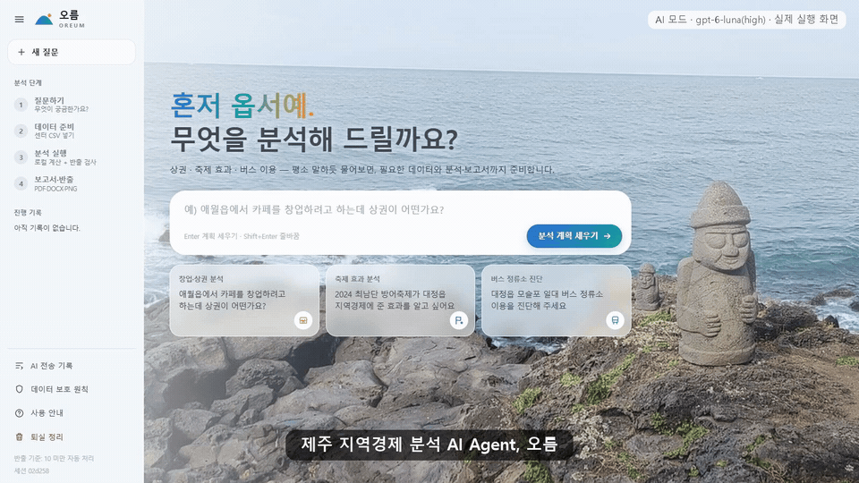

# 오름(OREUM) — 제주 지역경제 분석 AI Agent

> **질문 한 줄로, 반출 가능한 분석 보고서까지.**
> 제주빅데이터센터 분석실을 찾은 이용자(예비창업자·소상공인·공공기관·연구자)가 평소 말로 질문하면,
> 필요한 센터 데이터와 조회 조건을 안내하고, 내려받은 CSV를 넣으면 **센터 PC 안에서** 분석한 뒤
> **반출 기준을 자동으로 지킨 보고서(PDF·DOCX·PNG)와 반출 신청서 초안**까지 만들어 주는 AI Agent입니다.

「제주 AI·빅데이터 활용 AI Agent 개발 챌린지」 제출작



- 시연 영상(약 90초): **[YouTube](https://youtu.be/50ypJzED7m4)** · 파일 [`media/오름_시연_상권.mp4`](media/오름_시연_상권.mp4)
- 기획서(15쪽): [`docs/오름_AI_Agent_기획서.pdf`](docs/오름_AI_Agent_기획서.pdf)
- 검증 결과: [`docs/eval`](docs/eval) · 프롬프트: [`app/agent/prompts.py`](app/agent/prompts.py)

| 분석 | 이런 질문에 답합니다 | 센터 CSV 없이 바로(제주데이터허브 실데이터) | 센터 CSV를 넣으면 |
|---|---|---|---|
| ① 창업·상권 분석 | "애월읍에서 카페 창업하려는데 상권 어때?" | 카드매출·매장수(746) · 유동인구-매출(748) · 일별 유동인구(583 Open API) · 상가정보(793) | 최신 카드(1-08)·요일(1-12)·시간대(1-14)·시간대 유동인구(4-11)·버스 |
| ② 축제·행사 효과 | "2024 최남단 방어축제 지역경제 효과는?" | 축제(761) · 일별 유동인구(583) · 정류소(612)·정류소별 일 이용(613) | 시간대 유동인구(4-11)·시간대 승차(3-04)·업종 매출(1-08)·날씨(5-02) |
| ③ 버스 정류소·노선 진단 | "모슬포 버스 정류소 이용 진단해줘" | 정류소(612)·정류소별 일 이용(613) · 제주 전역 일별 시간대 승차(512) | 시간 단위 정류소 이용(3-04)·노선(3-02) |

> **가상 데이터를 쓰지 않습니다.** 센터 CSV가 없어도 위 제주데이터허브 **실데이터**로 세 분석이 모두 끝까지 동작하고,
> 센터 CSV를 넣으면 같은 화면에서 최신·세부 분석으로 바뀝니다.

---

## Agent가 일하는 방식

```
질문
  ↓
[계획 Agent: 생각 → 도구 호출(지역·업종·축제·데이터 검색) → 확정]
  ↓
데이터 준비 (AI 선택 표시)
  ↓
로컬 분석 (결정적 코드)
  ↓
반출 검사
  ↓
[해석 AI + 수치 검증]
  ↓
보고서
  ↓
[후속 질문 Agent: 도구 선택]
```

| AI가 하는 일 | 코드가 하는 일 |
|---|---|
| 질문 해석 및 분석 계획 수립 (도구 자율 선택·호출) | 센터 PC 안에서 로컬 계산 (통계·지표 산출) |
| 분석에 쓸 데이터 선정 및 고른 이유 제시 | 카탈로그·사전 조회 (원본 데이터 값은 보지 않음) |
| 반출 검사를 통과한 집계값 기반 결과 해석·제언 작성 | 반출 기준 자동 검사 (10 미만 비공개·범주처리·역산 방지) |
| 후속 질문 의도 파악 및 추가 분석 도구 선택 | AI 생성 문장 속 수치와 근거 표 자동 대조·검증 |

---

## 1. 빠른 시작 (센터 담당자용)

1. 압축을 풀고 폴더(예: `C:\OREUM`)를 엽니다. **경로에 한글이 있어도 동작**하지만, 가능하면 영문 경로를 권장합니다.
2. **`install.bat` 더블클릭** → 3~5분 뒤 "설치 완료" 확인 (인터넷 필요)
   - uv(파이썬 관리 도구)와 Python 3.12, 필요한 패키지를 자동 설치하고 자가 점검까지 수행합니다.
   - uv 설치가 막히면 PC에 설치된 Python(3.10 이상)으로 자동 전환합니다.
3. (선택) **AI 사용 설정**: 폴더의 `.env` 파일을 메모장으로 열어 `OPENAI_API_KEY=` 뒤에 센터가 발급한 키를 입력
   - 오름은 **OpenAI `gpt-6-luna`·추론 강도 high**로 전 과정을 검증했습니다. 키만 넣으면 같은 설정으로 동작합니다.
   - 키를 넣은 뒤 **`check_ai.bat`** 더블클릭 → `[정상]`이면 연결 완료. 요청 형식·발급 절차·문제 해결: **`docs/AI_API_설정_안내.md`**
   - 키가 없어도 **규칙 기반 모드**로 모든 분석·반출 검사·보고서 기능이 동작합니다. AI 해석 문장 대신 규칙 문장을 쓰고, 후속 질문은 규칙 라우터가 같은 분석 도구(지역 비교·표 조회·지표 설명)로 답합니다.
4. **`run.bat` 더블클릭** → 브라우저(Chrome/Edge)에서 `http://127.0.0.1:8765` 자동 열림
5. 하루 운영 종료 시 `cleanup_all.bat`(담당자용)으로 모든 이용자 작업 공간을 일괄 삭제할 수 있습니다.
6. (검증) `run_tests.bat` — 자동 테스트 195개(반출 규칙·역산 방지·LLM 관문·AI 경로 모의·CSV 인식·분석 효과 검출·허브 실데이터 경로·회귀) 약 1분
   - 에이전트 벤치마크 검증: `tools/eval_agent.py` (`plan --mode rule|ai`, `e2e`) 실행 시 결과는 `docs/eval/`에 JSON·MD로 저장

`install.bat`은 여러 번 실행해도 안전합니다(기존 가상환경 재사용).

### 바로 해 보기(실데이터)
화면의 예시 질문 3개를 누르고 → 「이 계획으로 데이터 준비」 → 「분석 실행」을 누르면 센터 CSV 없이도
제주데이터허브 실데이터로 보고서가 만들어집니다(규칙 기반 모드 기준 3~10초).

- 내장 실데이터: 허브 공개 파일(746·748·793·761·512)과 Open API 스냅샷(583·612·613, 대표 시나리오 지역·기간)
- `.env`에 `JEJU_HUB_PROJECT_KEY`(제주데이터허브 프로젝트 키)를 넣으면, 스냅샷에 없는 지역·기간의 **일별 유동인구(583)를 Agent가 직접 Open API로 조회**합니다(캐시·일일 쿼터 보호).
- 스냅샷 다시 만들기: `tools\fetch_hub_api.py`(키 필요, 사용법은 파일 머리말)

## 2. 이용자 사용 흐름

1. **질문하기** — 예시 버튼 또는 직접 입력 → 에이전트가 도구를 호출하며 생각·도구 호출·결과를 **실시간 작업 기록**으로 보여주고, 분석 유형·지역·업종·행사 기간 및 **오름이 고른 데이터**(데이터 ID와 이유)를 확정(수정 가능). 상권·축제·버스 분석 밖의 질문은 거절하지 않고 관련 데이터·기간·반출 등급을 **데이터 탐색**으로 안내
2. **데이터 준비** — 화면의 체크리스트에 표시된 **'AI 선택'/'AI 추천'**과 **오름이 고른 이유**를 확인하고, 센터 조회 화면에서 **한 달씩 CSV**를 받아 끌어다 놓기 → 종류·기간 자동 인식
3. **분석 실행** — 로컬 계산 → **반출 기준 자동 검사**(10 미만 범주처리·삭제처리·역산 방지) → 차트 → AI 해석 → 보고서
4. **보고서·반출** — 결과 화면 5개 탭(분석 결과 / 제언·활용 문안 / 근거 자료 / 반출 검사 / **작업 과정**) 확인. PDF/DOCX/PNG 다운로드, **반출 신청서 초안 복사** → 센터 시스템에 반출 신청. '작업 과정' 탭에서 AI·도구 호출 수, 반출 검사 통과, AI 비용 요약 및 ① 계획(도구 기록) ② 실행(이 PC 계산 단계) ③ AI에 보낸 것(반출 검사 통과 표 목록 + AI 전송 기록 버튼) ④ 후속 질문 도구 확인
5. **퇴실 정리** — 상단 「퇴실 정리」 버튼으로 업로드 CSV·결과·AI 전송 기록 전부 삭제

## 3. 데이터 보호 설계

| 원칙 | 구현 |
|---|---|
| 원본 데이터는 PC 밖으로 나가지 않음 | 모든 계산은 로컬 pandas. 원본 행을 화면·LLM에 출력하는 함수가 없음 |
| LLM에는 반출 기준을 통과한 집계값만 | `app/guard/llm_gate.py` — 검사 통과 표만 직렬화, 모든 전송 내용을 감사 로그로 화면 공개 |
| 10 미만 단순집계 반출 불가 | `app/guard/export_guard.py` — 범주처리(상위 단위 재집계) 우선, 불가 시 삭제처리 + **보완 억제(합계로 역산 방지)** |
| 기반 건수가 작은 비율도 보수적으로 | 금액·비율 셀은 기반 이용건수 10 미만이면 비공개 |
| 텍스트·스프레드시트 반출 불가 | 결과물은 PDF·DOCX 보고서와 PNG 그림만 생성 |
| 퇴실 시 삭제 | 세션 폴더(`workspace/<세션>`) 단위 삭제, 반출 승인본만 `approved_outputs/`로 보존 가능 |

## 4. 실행 환경·의존성

- 대상: Windows 11, Intel i7-8700, RAM 32GB (GPU 불필요 — 외부 LLM API 사용, 로컬 계산은 CPU)
- Python 3.12 / 패키지: `requirements.txt` (FastAPI, uvicorn, pandas, numpy, pyarrow, matplotlib, Jinja2, python-docx, python-dotenv, openai, anthropic)
- 브라우저: Chrome 또는 Edge(1920×1080 최적화). PDF는 설치된 Edge/Chrome의 헤드리스 인쇄로 생성
- 외부 접속 주소(센터 허용 목록 등록 권장)

| 주소 | 용도 | 시점 |
|---|---|---|
| `api.openai.com` | OpenAI API(질문 해석·보고서 문장·후속 질문) | 실행 중(선택) |
| `api.anthropic.com` | Claude API(제공자를 anthropic으로 바꿀 때만) | 실행 중(선택) |
| `astral.sh`, `github.com`, `pypi.org`, `files.pythonhosted.org` | uv·Python·패키지 설치 | 설치 시 1회 |
| `tile.openstreetmap.org` | 화면 지도 배경 타일 | 실행 중(없어도 동작) |
| `open.jejudatahub.net` | 제주데이터허브 Open API(선택, 프로젝트 키 필요) | 실행 중(선택) |

## 5. 환경변수 (`.env`)

`.env.example` 참고. 주요 항목: `OPENAI_API_KEY`(선택), `OREUM_LLM_PROVIDER`(기본 `openai`, 또는 `anthropic`), `OREUM_LLM_MODEL`(기본 `gpt-6-luna`),
`OREUM_LLM_EFFORT_PLAN`·`OREUM_LLM_EFFORT_WRITE`(기본 `high`),
`JEJU_HUB_PROJECT_KEY`(선택), `OREUM_PORT`(기본 8765), `OREUM_MIN_CELL`(기본 10).

## 6. 폴더 구조

```
app/        서버·에이전트·분석·반출검사·보고서 코드
  agent/    planner(질문 해석) · plan_tools(계획 도구 5종) · prompts(프롬프트 모음) · orchestrator(실행) · narrator(해석 작성·수치 검증) · llm(OpenAI·Claude 호출·감사 로그) · resolve(지역·업종·행사 해석, 데이터 안내)
  analysis/ trade_area · event_impact · transit (결정적 로컬 계산)
  guard/    export_guard(반출 기준) · llm_gate(LLM 전송 관문)
  catalog/  명세서 카탈로그·지역·업종·축제 사전 / ingest/ CSV 인식·병합 / hub/ 제주데이터허브 공개데이터·API
  report/   차트(PNG)·보고서(HTML→PDF, DOCX)
web/        화면(HTML/CSS/JS, 빌드 불필요)
data/public 제주데이터허브 실데이터 전처리본 + Open API 스냅샷(출처·처리 내역: PROVENANCE.json)
tools/      build_catalog · prepare_public(허브 파일) · fetch_hub_api(허브 Open API 스냅샷) · selfcheck · make_demo_data(테스트용 형식 검증 데이터) · eval_agent(에이전트 검증)
tests/      자동 테스트(pytest, run_tests.bat)
docs/       사용자 매뉴얼·AI(API) 설정 안내·데이터 활용 명세·결과 설명자료·AI 전송 예시(AI에 보내는 실제 내용) — docs/pdf/ 에 PDF본, docs/eval/ 에 평가 결과(JSON·MD)
```

## 7. 오류·제약사항

- 카드 데이터는 **비씨카드 결제분**, 유동인구는 **통신사 기반 추정치**로 전체 모집단과 다를 수 있습니다.
- 카드 데이터는 월 단위라 며칠짜리 행사 효과는 한 달에 희석됩니다(보수적 추정으로 표시).
- 법정동→7개 권역 대응은 공식 표가 없어 추정 매핑을 쓰며, CSV에 `dstrct_se` 값이 있으면 그 값을 우선합니다.
- 정류소의 지역 배정은 좌표 반경 기준(경계 파일 미사용) 근사입니다.
- 허브 카드 매쉬업(746·748)은 2017.01~2021.05 자료(코로나19 기간 포함)라 현재 상권과 다를 수 있습니다. 보고서에 기간을 함께 표시합니다.
- 허브 613(정류소별 일 이용)과 612(정류소 정보)는 정류소 ID 체계가 달라 **정류소 이름으로 연결**합니다(승차 기준 약 97% 일치, 양방향 정류소는 합산).
- 허브 583·613은 일 단위라 시간대 분석(붐비는 시각)은 센터 4-11·3-04를 넣었을 때만 나옵니다.
- AI 연결이 안 되면(키 없음·네트워크·한도) 같은 계산 결과로 규칙 기반 문장이 자동으로 들어갑니다. 센터 보안정책(DLP)으로 외부 전송이 차단되는 경우 `.env`에서 `OREUM_LLM_ENABLED=0`.
- 자세한 문제 해결은 `docs/사용자_매뉴얼.md`를 참고하세요.

## 8. 사용 AI·오픈소스·외부 데이터

- AI 모델: OpenAI `gpt-6-luna`(추론 강도 high, Responses API·엄격 JSON 스키마) 기본 — 질문 해석, 결과 해석 문장, 후속 질문(도구 선택).
  설정으로 Anthropic Claude(`claude-opus-5-5`)로 바꿀 수 있음. 개발 중 검증은 같은 모델·같은 추론 강도·같은 프롬프트를
  Codex CLI(`OREUM_LLM_PROVIDER=codex`, 개발자 로컬 전용)로 실행해 수행
- 개발 시 AI 활용: 코드·문서 작성 보조에 Claude Code 사용
- 오픈소스: FastAPI(MIT), Uvicorn(BSD), pandas(BSD), NumPy(BSD), PyArrow(Apache-2.0), Matplotlib(PSF 기반), Jinja2(BSD),
  python-docx(MIT), python-dotenv(BSD), openai SDK(Apache-2.0), anthropic SDK(MIT), Leaflet 1.9.4(BSD-2), Pretendard 1.3.9 글꼴(SIL OFL 1.1, `web/vendor/fonts`), 화면 배경(`web/vendor/bg` — 제주 해안·돌하르방 실사 사진은 Pixabay 7910450(Pixabay Content License, 무료), 파도는 Wan2.2-TI2V-5B 영상화, 상세 `CREDITS.txt`), OpenStreetMap 타일(ODbL, 화면 표시용)
- 데이터: 제주빅데이터센터 제공데이터(명세서 v13), 제주데이터허브 공개 데이터(상가(상권) 정보, 축제행사, 예비창업자 카드매출·매장수 매쉬업,
  유동인구-카드매출 매쉬업, 일별 시간대별 버스 승차)와 Open API(읍면동 단위 내국인 유동인구, 버스 정류소 기본 정보, 일일 정류소별 버스 이용자) — 상세는 `docs/데이터_활용_명세.md`
- 결과물 표기: 「제주 AI·빅데이터 활용 AI Agent 개발 챌린지」 제출작
